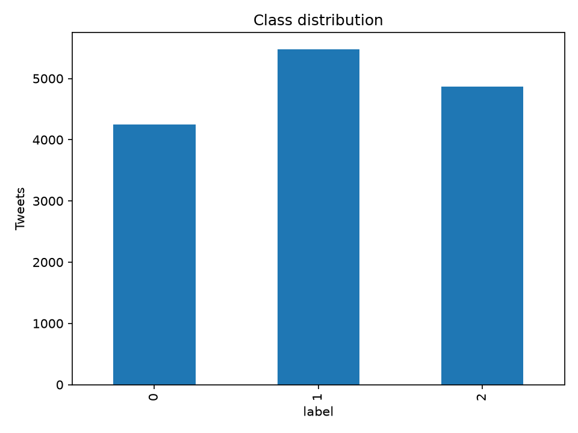
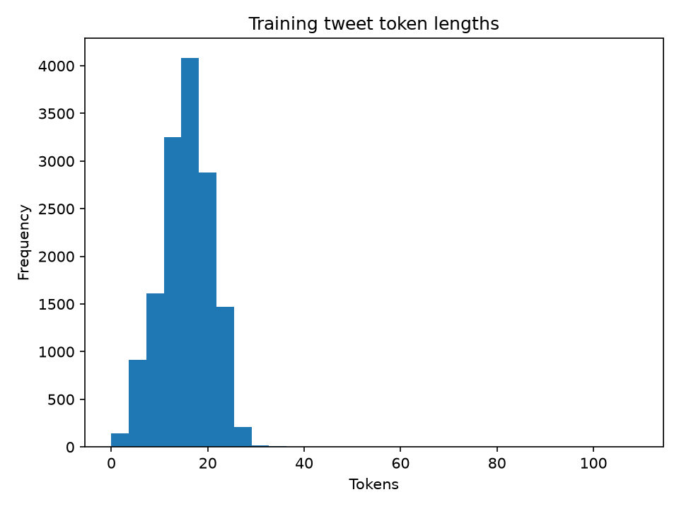
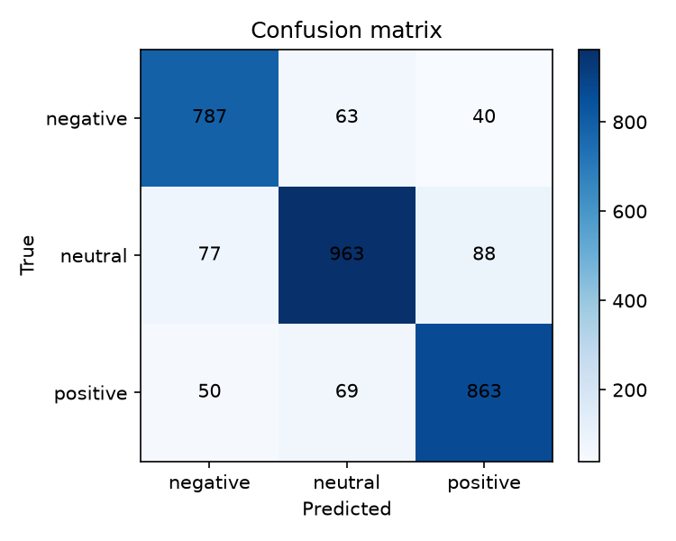

# Presentation Script: Hinglish Sentiment Analysis

_4 speakers · about 12-14 minutes · 4 main slides + 2 minutes Q&A_

| Speaker                    | Main slide | Role                                                   |
| -------------------------- | ---------- | ------------------------------------------------------ |
| Suraj / Person 1           | 1          | Data, NLP analysis, preprocessing, and demo            |
| Subhadeep Das / Person 2   | 2          | Classical baselines, embeddings, and CNN               |
| Aayush Kumar / Person 3    | 3          | Recurrent and hybrid neural models                     |
| Sudeshna Kumari / Person 4 | 4          | Evaluation, error analysis, deployment, and conclusion |

## Slide 1: Data, Preprocessing, and Problem (Suraj / Person 1)

**Speaker:** Suraj

**Suggested screen:**

- Project title: **HinglishPulse**
- One or two real Hinglish tweets
- `figures/class_distribution.png`
- `figures/token_length_histogram.png`





**Short script:**

> Good morning. We are the HinglishPulse team, and our project is sentiment analysis for Hinglish, Hindi and English written together in Roman script. The problem is that Hinglish has unstable spelling, frequent slang, mixed grammar, and almost one in three test words may be unseen.
>
> We use the official SemEval-2020 Task 9 dataset: 20,594 tweets, split into 14,594 training, 3,000 validation, and 3,000 test tweets. The three labels are Negative 0, Neutral 1, and Positive 2. The training split is 29.1% Negative, 37.5% Neutral, and 33.4% Positive.
>
> The training vocabulary contains 30,978 words, while the test vocabulary contains 10,914 words. The OOV rate is 30.25%, so character and subword representations are necessary. Typical tweets contain 18.42 ± 9.14 tokens, and we use a maximum length of 35 tokens.
>
> My preprocessing pipeline uses TweetTokenizer, removes URLs and mentions, keeps hashtag words, collapses long character repetitions, and maps variants such as `nahin`, `nahee`, and `nahein` to `nahi`. For example, `Soooo happy with this!! Lekin nahin chal rha :)` becomes `soo happy with this lekin nahi chal rha`.
>
> Everything is reproducible: split schemas are fixed, vocabulary and spelling resources are fitted only on training data, and H1/H2 manifests record SHA-256 checksums.

**Files to prepare:**

- `src/preprocess.py`
- `src/eda.py`
- `data/processed/preprocessor.json`
- `data/processed/H1_MANIFEST.json`
- `data/processed/H2_MANIFEST.json`
- `notebooks/eda.ipynb`
- `backend/main.py`
- `frontend/`

---

## Slide 2: Classical Baseline, FastText, and CNN (Subhadeep Das / Person 2)

**Speaker:** Subhadeep Das

**Suggested screen:**

- Word TF-IDF + Logistic Regression baseline
- Character TF-IDF explanation
- FastText nearest-neighbor table
- CNN architecture diagram

**CNN architecture:**

```text
Token IDs
  ↓
128-d Embedding
  ↓
Conv1D k=2 ─┐
Conv1D k=3 ─┼→ ReLU → Global Max Pool → Concatenate → Dropout → Softmax
Conv1D k=4 ─┘
```

**FastText nearest neighbors for `good`:**

| Neighbor  | Similarity |
| --------- | ---------: |
| goodmorn  |     0.9504 |
| goodd     |     0.9471 |
| morn      |     0.9219 |
| goodluck  |     0.9174 |
| goodnight |     0.9116 |

**Short script:**

> My work builds the non-neural baseline and feature representations. For classical modelling, word TF-IDF uses 1-grams and 2-grams, while character TF-IDF uses 2–5 character n-grams to absorb spelling variation.
>
> Logistic Regression with word TF-IDF reaches 87.10% accuracy and 87.12% Macro F1. It gives us a strong and interpretable baseline.
>
> We then train FastText on the training corpus with 16-dimensional vectors and subword n-grams. This handles unseen variants such as `zabardaaast` instead of assigning a zero vector. The nearest neighbors of `good` include `goodmorn`, `goodd`, `morn`, and `goodnight`.
>
> The CNN reads 128-dimensional token embeddings through parallel convolutions of size 2, 3, and 4, then applies ReLU and global max pooling. It reaches 90.23% accuracy and 90.35% Macro F1, outperforming TF-IDF and showing that local Hinglish phrases matter.

**Files to prepare:**

- `src/features.py`
- `src/classical.py`
- `src/models.py`
- `notebooks/classical_baseline.ipynb`
- `notebooks/embeddings.ipynb`
- `embeddings/vocab.json`
- `embeddings/fasttext.model`
- `results/results.csv`

---

## Slide 3: Recurrent and Hybrid Neural Models (Aayush Kumar / Person 3)

**Speaker:** Aayush Kumar

**Suggested screen:**

- Compact architecture diagrams
- Main model comparison table
- Training curve or `src/train.py` early-stopping flow

**Architecture summary:**

```text
LSTM:        Embedding → LSTM → Linear
BiLSTM:      Embedding → Forward LSTM + Backward LSTM → Concatenate → Linear
CNN:         Embedding → 1D Conv k=2/3/4 → Max Pool → Linear
BiLSTM+Conv: Embedding → BiLSTM → Conv1D k=3 → Avg Pool + Max Pool → Linear
```

**Main results:**

| Model               |   Accuracy |   Macro F1 |
| ------------------- | ---------: | ---------: |
| Logistic Regression |     87.10% |     87.12% |
| LSTM                |     89.87% |     90.01% |
| 1D CNN              |     90.23% |     90.35% |
| BiLSTM              |     91.53% |     91.61% |
| **BiLSTM+Conv1D**   | **91.57%** | **91.64%** |

**Short script:**

> I implemented four PyTorch neural baselines and the training pipeline. LSTM reads a tweet left to right. BiLSTM reads in both directions, allowing each word to use context before and after it.
>
> The champion model is BiLSTM+Conv1D. The BiLSTM produces 256-dimensional context-aware representations, a kernel-3 convolution extracts local patterns, and average plus max pooling combine sentence-level and strongest-signal information.
>
> All models use validation from the official split, seed 42, Adam, gradient clipping, and early stopping on validation Macro F1. The champion reaches 91.57% accuracy and 91.64% Macro F1.
>
> It improves over Logistic Regression by 4.47 accuracy points and 4.52 Macro F1 points. The 0.04 accuracy and 0.03 Macro F1 differences over plain BiLSTM are small, so with one seed we cannot claim significance without more seeds.

**Files to prepare:**

- `src/models.py`
- `src/train.py`
- `src/dataset.py`
- `data/processed/preprocessor.json`
- `embeddings/vocab.json`
- `results/results.csv`

---

## Slide 4: Evaluation, Error Analysis, and Deployment (Sudeshna Kumari / Person 4)

**Speaker:** Sudeshna Kumari

**Suggested screen:**

- `figures/confusion_matrix.png`
- Per-class metric table
- Live FastAPI/React dashboard screenshot
- Three-takeaway conclusion



**Per-class champion results:**

| Class    | Precision | Recall |     F1 |
| -------- | --------: | -----: | -----: |
| Negative |    86.10% | 88.43% | 87.25% |
| Neutral  |    87.95% | 85.37% | 86.64% |
| Positive |    87.08% | 87.88% | 87.48% |

**Short script:**

> I evaluated the models using accuracy, Macro F1, weighted F1, a classification report, and a 3 × 3 confusion matrix. We use Macro F1 because it treats all three sentiment classes equally.
>
> Neutral is the hardest class: 77 Neutral tweets were predicted Negative and 88 were predicted Positive. The manual error analysis found four major categories: Neutral/Negative ambiguity 60%, negation inversion 26%, sarcasm or emoticon mismatch 7%, and phonetic spelling variants 7%.
>
> We also built and deployed the complete platform. FastAPI provides `/api/analyze`, batch inference, live statistics, and benchmark endpoints. The React dashboard shows sentiment probabilities, language mix, token-level information, model results, and the confusion matrix.
>
> Our three conclusions are: (1) bidirectional context is the largest neural improvement, (2) local convolutional features provide the best combined performance, and (3) neutral ambiguity and negation remain the main limitations.
>
> Future work is multi-seed validation, transformer fine-tuning, attention or saliency, and more robust transliteration.

**Files to prepare:**

- `src/evaluate.py`
- `src/error_analysis.py`
- `notebooks/evaluation.ipynb`
- `notebooks/error_analysis.ipynb`
- `results/results.csv`
- `results/classification_report.csv`
- `figures/confusion_matrix.png`
- `backend/main.py`
- `backend/model_loader.py`
- `frontend/`

---

## Live Demo

Use the React dashboard or FastAPI `/api/analyze` endpoint.

- Positive example: `bahut accha product hai, mujhe pasand aaya`
- Negative example: `product bilkul bekar tha, mat lena`
- Neutral example: `aaj ka match theek thaak raha, kuch khaas nahi`
- Spelling-variant example: `nahin`, `nahee`, or `nahein`

Show:

1. the predicted label;
2. Negative, Neutral, and Positive probabilities;
3. Hindi/English/mixed language proportions;
4. benchmark or model leaderboard.

If the demo is unavailable, use the recorded backup and the confusion-matrix figure.

---

## Short Q&A Answers

| Question                                    | Answer                                                                                                          |
| ------------------------------------------- | --------------------------------------------------------------------------------------------------------------- |
| Why BiLSTM over LSTM?                       | BiLSTM reads in both directions, so a word can use context before and after it.                                 |
| Why is Neutral hardest?                     | Ambiguous wording and mild complaints overlap with both negative and positive language.                         |
| Why FastText?                               | Subword vectors handle spelling variants and unseen Hinglish words.                                             |
| Why Macro F1?                               | It gives every sentiment class equal weight.                                                                    |
| Is the hybrid improvement significant?      | Not with one seed; a small 0.04 accuracy gain requires multi-seed validation.                                   |
| Did we implement attention or transformers? | They are proposed future work in the report; the implemented benchmark is LSTM, BiLSTM, CNN, and BiLSTM+Conv1D. |
| What would you improve first?               | Multi-seed experiments and more robust spelling/transliteration, followed by transformer fine-tuning.           |

## Rehearsal Checklist

- Keep each main slide to about 3 minutes.
- Change only names in the speaking labels if the team uses a different mapping.
- Open the two EDA figures, CNN architecture, confusion matrix, and live demo before presenting.
- Make sure every spoken number matches `results/results.csv` and `results/classification_report.csv`.
